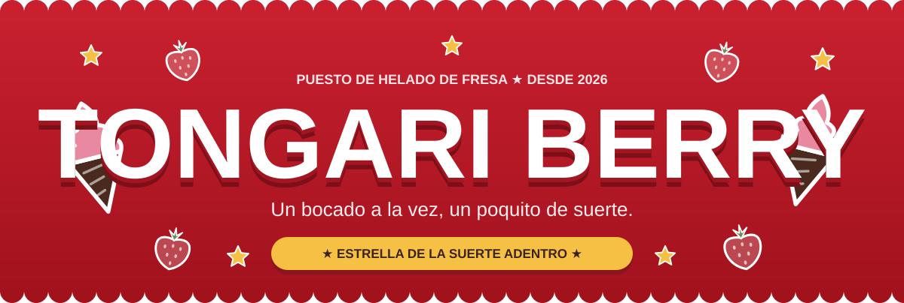
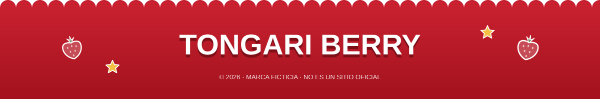

<div align="center">



<br>

### ★ Un bocado a la vez, un poquito de suerte ★

*Si aparece una estrella en el fondo de tu cono, te llevas otro gratis.*

<br>


<br><br>

[🍦 **Menú**](#-el-tongari-de-hoy) &nbsp;·&nbsp; [⭐ **Cómo funciona la suerte**](#-estrella-de-la-suerte) &nbsp;·&nbsp; [🎨 **Estilo**](#-paleta-y-estilo) &nbsp;·&nbsp; [🚀 **Instalación**](#-instalación-y-ejecución)

</div>

<p align="center">★ ☆ ★ ☆ ★ ☆ ★ ☆ ★</p>

## 📸 Vista previa

<div align="center">

`PANTALLA DE INICIO`

</div>

<p align="center">
  
</p>

<div align="center">

`DEMOSTRACIÓN`

</div>

<p align="center">
  
</p>

<p align="center">★ ☆ ★ ☆ ★ ☆ ★ ☆ ★</p>

## 📖 Acerca del proyecto

**Tongari Berry** es la web de un puesto de helado de fresa: conos con espiral puntiaguda, una estrella de la suerte escondida en el fondo y una carpa roja que cambia de lugar cada semana. Todo en una interfaz juguetona, animada y 100% responsive.

Nació como práctica de desarrollo frontend, aplicando arquitectura basada en componentes, reutilización de código, manejo de estados con Hooks y diseño adaptable a cualquier pantalla.

> 🍓 Funciona completamente en el navegador, con datos locales. Sin backend, sin base de datos, sin complicaciones.

### 🎯 Objetivos

- ⭐ Aplicar los fundamentos de React y JavaScript moderno.
- 🧩 Construir una arquitectura de componentes reutilizables.
- 🎬 Crear interfaces dinámicas con animaciones e interacciones.
- 📱 Lograr un diseño responsive de verdad.
- 🧹 Mantener un código ordenado y fácil de mantener.

<p align="center">★ ☆ ★ ☆ ★ ☆ ★ ☆ ★</p>

<div align="center">

`EL CONO DE HOY`

</div>

## 🍦 El Tongari de hoy

Helado suave en espiral con punta, servido a la temperatura perfecta. El cono se hornea fresco cada mañana.

<table align="center">
  <tr>
    <td align="center" width="33%">
      <h3>🍓 Tongari Fresa</h3>
      <code>FRESA</code> &nbsp; ⭐ <code>SUERTE</code>
      <p>Helado suave de fresa pura con una espiral bien puntiaguda.</p>
      <b><code>$9.900</code></b>
    </td>
    <td align="center" width="33%">
      <h3>🍫 Tongari Choco</h3>
      <code>CHOCOLATE</code>
      <p>Espiral de cacao intenso, hecha para mantenerse firme hasta el último bocado.</p>
      <b><code>$9.900</code></b>
    </td>
    <td align="center" width="33%">
      <h3>🌀 Mezcla Twist</h3>
      <code>TWIST</code>
      <p>Dos sabores enrollados juntos. Cada bocado sabe diferente.</p>
      <b><code>$10.900</code></b>
    </td>
  </tr>
</table>

<p align="center">★ ☆ ★ ☆ ★ ☆ ★ ☆ ★</p>

<div align="center">

`ESTRELLA DE LA SUERTE`

</div>

## ⭐ Estrella de la suerte

Algunos conos esconden una estrella en el fondo. Termina el tuyo, encuentra la estrella y el siguiente va por la casa.

<table align="center">
  <tr>
    <td align="center" width="33%">
      <code>PASO 01</code>
      <h3>🍦 Elige</h3>
      Escoge cualquier cono. Todos pueden guardar una sorpresa.
    </td>
    <td align="center" width="33%">
      <code>PASO 02</code>
      <h3>😋 Disfruta</h3>
      Con calma. Los bocados lentos revelan la estrella.
    </td>
    <td align="center" width="33%">
      <code>PASO 03</code>
      <h3>⭐ Muestra</h3>
      Enseña la estrella en la ventanilla y llévate un cono gratis.
    </td>
  </tr>
</table>

> 🎮 **¿Y en la web?** También hay un minijuego: tocas uno de los tres conos y descubres si la estrella estaba adentro. ¡Si sale, lluvia de confeti! 🎉

<p align="center">★ ☆ ★ ☆ ★ ☆ ★ ☆ ★</p>

<div align="center">

`LO QUE TRAE LA WEB`

</div>

## ✨ Características principales

| | Característica | Descripción |
|:---:|---|---|
| 🏠 | **Hero animado** | Título que rebota letra por letra, con conos, fresas y estrellas flotando de fondo. |
| 🖱️ | **Efecto parallax** | Los elementos decorativos siguen el mouse y rotan al hacer scroll. |
| 🎉 | **Confeti interactivo** | Toca una fresa, una estrella o el cono y estalla en confeti. |
| 🏷️ | **Cinta en marquesina** | Dos cintas inclinadas con mensajes que se desplazan sin parar. |
| 🍦 | **Tarjetas inclinadas** | Aparecen escalonadas al hacer scroll y se levantan al pasar el cursor. |
| 🎮 | **Minijuego de la suerte** | Tres conos, una sola estrella. ¿Cuál la esconde? |
| 📅 | **Dónde estamos** | Paradas y horarios del puesto durante la semana. |
| 📊 | **Barra de progreso** | Una línea de colores que avanza mientras recorres la página. |
| 🌙 | **Modo oscuro automático** | Se adapta a la preferencia de tu sistema. |
| ♿ | **Accesible** | Respeta `prefers-reduced-motion` para quien prefiere menos animaciones. |
| 📱 | **Responsive** | Móvil, tablet y escritorio. |

<p align="center">★ ☆ ★ ☆ ★ ☆ ★ ☆ ★</p>

<div align="center">

`EL LOOK`

</div>

## 🎨 Paleta y estilo

Un estilo de dulcería: colores planos, bordes gruesos, sombras duras y bordes festoneados como la carpa del puesto.

| Color | Código | Uso |
|:---:|:---:|---|
|  | `--red` | Rojo fresa: barra de navegación, hero y footer. |
|  | `--gold` | Dorado estrella: botones, precios y cintas. |
|  | `--brown` | Marrón cacao: texto, bordes y sombras duras. |
|  | `--pink` | Rosa helado: sección de la suerte y detalles de las tarjetas. |
|  | `--cream` | Crema: fondo general. |

**Tipografía:** [Fredoka](https://fonts.google.com/specimen/Fredoka), redondeada y amistosa, con pesos de 400 a 700.

<p align="center">★ ☆ ★ ☆ ★ ☆ ★ ☆ ★</p>

## 🛠️ Tecnologías utilizadas

| | Tecnología | Para qué |
|:---:|---|---|
| ⚛️ | **React 18** | Interfaz basada en componentes. |
| 🟨 | **JavaScript ES6+** | Lenguaje principal del proyecto. |
| ⚡ | **Vite 5** | Servidor de desarrollo y compilación. |
| 🧭 | **React Router DOM** | Navegación entre vistas. |
| 🎨 | **CSS3** | Estilos, animaciones y diseño responsive. |
| 🪝 | **React Hooks** | Estado y lógica de los componentes. |
| 🌿 | **Git y GitHub** | Control de versiones y repositorio. |

<p align="center">★ ☆ ★ ☆ ★ ☆ ★ ☆ ★</p>

## 🚀 Instalación y ejecución

**Requisitos previos:** Node.js 18 o superior, npm y Git.

**1. Clona el repositorio**

```bash
git clone https://github.com/majopan/Puesto-de-Helados.git
```

**2. Entra al proyecto**

```bash
cd Puesto-de-Helados
```

**3. Instala las dependencias**

```bash
npm install
```

**4. Arranca el servidor de desarrollo**

```bash
npm run dev
```

**5. Genera la versión de producción**

```bash
npm run build
```

<p align="center">★ ☆ ★ ☆ ★ ☆ ★ ☆ ★</p>

## 📌 Alcance del proyecto

Tongari Berry es una aplicación **exclusivamente frontend**:

- 🚫 Sin backend.
- 🚫 Sin base de datos.
- 🚫 Sin autenticación de usuarios.
- ✅ Los datos de los productos viven en el propio código.
- ✅ Todo funciona directamente en el navegador.

## 🔮 Posibles mejoras futuras

- [ ] 🛒 Carrito de compras.
- [ ] 🏷️ Filtros por categoría y sabor.
- [ ] 🔍 Búsqueda de productos.
- [ ] 🔌 Conectar con una API.
- [ ] 🗄️ Backend para administrar productos y pedidos.
- [ ] 👤 Autenticación y gestión de usuarios.

<p align="center">★ ☆ ★ ☆ ★ ☆ ★ ☆ ★</p>

## 👩🏻‍💻 Autora

<div align="center">

**María José Jiménez Díaz**

Desarrolladora de Software · Frontend Developer

<a href="https://github.com/majopan"></a>

</div>

## 📄 Licencia

Este proyecto se encuentra bajo la licencia **MIT**. Consulta el archivo `LICENSE` para más información.

<br>

<p align="center">
  
</p>
